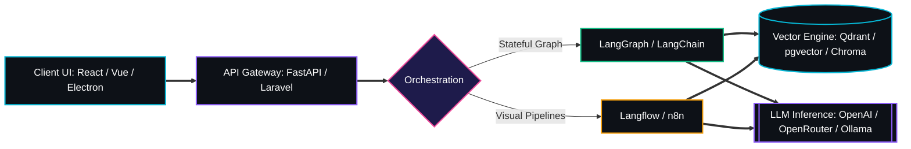

  <!-- HERO COVER BANNER -->
  

  <!-- MULTI-STAGE TERMINAL TELEMETRY -->
  

   

  <!-- CORE PILLARS (DARK BASE + NEON ACCENT) -->
  

    
    
    
    
  

<!-- NEON PULSE DIVIDER -->

## `01 // OVERVIEW`

<table>
  <tr>
    <td width="62%" valign="middle">
      

        I build <b>AI systems and web applications</b> with a focus on practical use.
      

      

        My main interests are <b>AI agents, RAG, multi-agent workflows, and backend systems</b>. I also work with full-stack development to turn AI workflows into complete products.
      

      <pre lang="yaml"><code>system_profile:
  role: "AI Engineer & Full-Stack Builder"
  domains:
    - Autonomous Agents & Multi-Agent Workflows
    - Retrieval-Augmented Generation (RAG)
    - High-Concurrency Backend & Queue Systems
    - End-to-End Web & Desktop Applications
  principle: "Build useful things. Keep them simple."</code></pre>
    </td>
    <td width="38%" valign="middle" align="center">
      
    </td>
  </tr>
</table>

## `02 // AI ARCHITECTURE & ORCHESTRATION`

  <h4>[ AI & LLM CAPABILITIES ]</h4>
  

    
    
    
    
    
  

  <h4>[ FRAMEWORKS & AUTOMATION ]</h4>
  

    
    
    
    
  

## `03 // TECH STACK`

   
  
    

<table width="100%">
  <tr>
    <td width="50%" valign="top">
      <h3 align="center"><code>[ BACKEND ]</code></h3>
      

        
        
        
        
      

      <ul>
        <li>Python & FastAPI</li>
        <li>PHP / Laravel</li>
        <li>REST APIs</li>
        <li>Background jobs</li>
        <li>Queue-based workflows</li>
      </ul>
    </td>
    <td width="50%" valign="top">
      <h3 align="center"><code>[ FRONTEND ]</code></h3>
      

        
        
        
      

      <ul>
        <li>React</li>
        <li>Vue.js</li>
        <li>Electron.js</li>
        <li>AI-powered web interfaces</li>
      </ul>
    </td>
  </tr>
  <tr>
    <td width="50%" valign="top">
      <h3 align="center"><code>[ DATA & VECTOR SEARCH ]</code></h3>
      

        
        
        
        
        
      

      <ul>
        <li>PostgreSQL & Supabase</li>
        <li>pgvector</li>
        <li>Chroma</li>
        <li>Qdrant</li>
      </ul>
    </td>
    <td width="50%" valign="top">
      <h3 align="center"><code>[ LLM APIS & TOOLS ]</code></h3>
      

        
        
        
        
        
      

      <ul>
        <li>OpenAI SDK</li>
        <li>OpenRouter</li>
        <li>Ollama</li>
        <li>Git & Docker</li>
      </ul>
    </td>
  </tr>
</table>

## `04 // CURRENT FOCUS`

  

  

    
    
    
    
  

  

