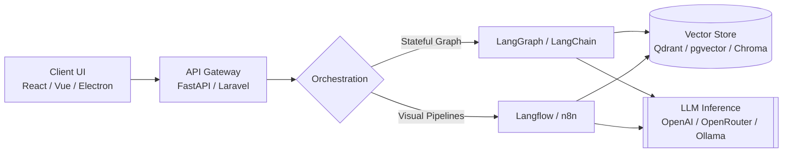

# AI Engineer & Full-Stack Developer

I build **AI systems and web applications** with a focus on practical production use. My core work centers around **AI agents, Retrieval-Augmented Generation (RAG), multi-agent workflows, and scalable backend systems**, combined with full-stack development to turn AI pipelines into complete end-to-end products.

> *"Build useful things. Keep them simple."*

---

## System Architecture & Orchestration

Typical architecture for the AI applications and multi-agent systems I design and deploy:

---

## Technical Stack

| Category | Technologies & Tools |
| :--- | :--- |
| **AI & Orchestration** | LangGraph, LangChain, Langflow, n8n, Autonomous Agents, Multi-Agent Workflows, RAG Pipelines |
| **LLM & Inference** | OpenAI SDK, OpenRouter, Ollama, Embeddings, Semantic & Vector Search |
| **Backend** | Python, FastAPI, PHP, Laravel, REST APIs, Background Jobs, Queue-based Workflows |
| **Data & Vector Stores** | PostgreSQL, Supabase, pgvector, Qdrant, Chroma |
| **Frontend & Desktop** | React, Vue.js, Electron.js |
| **Infrastructure & DevOps** | Docker, Git |

---

## Current Focus

- Designing reliable **multi-agent workflows** with deterministic state control.
- Optimizing **RAG pipelines** for accuracy, low latency, and production scale.
- Building high-concurrency **LLM backends** with asynchronous task queues.
- Developing **end-to-end AI products** across web and desktop platforms.
